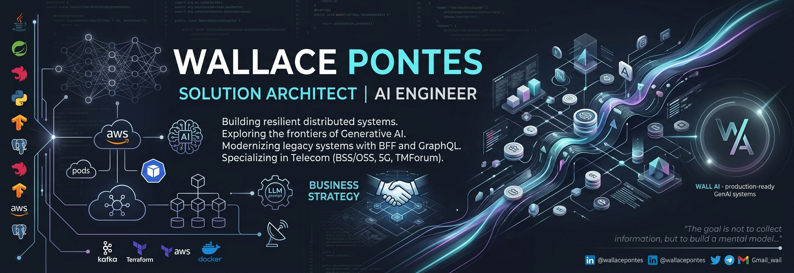

# Hi there, I'm Wallace Pontes 👋

**AI Engineer | Solutions Architect | Tech Strategist** 

Architecting intelligent systems, pushing the boundaries of Generative AI, and bridging cutting-edge AI research with enterprise-grade business value.

---

## 🚀 AI-First Engineering & Architecture

I specialize in transitioning AI from experimental models to robust, enterprise-ready systems. Combining heavy backend architectural principles with modern AI paradigms, I build scalable intelligent solutions.

- **🤖 AI & Generative AI:** Specialized in **LLM Architectures**, **Agentic Workflows**, **RAG Systems**, **Mixture of Experts (MoE)**, and fine-tuning models for production deployment at **[Wall AI](https://www.wallai.com.br/)**.
- **🧠 Core AI Engineering:** Focus on prompt orchestration, vector database design, model optimization, latency minimization, and AI safety/evals.
- **🏗️ Enterprise Architecture:** Expert in **Microservices**, **BFF**, **GraphQL Federation**, and **Event-Driven Architectures** to support AI data pipelines.
- **📡 Domain & Business Strategy:** Deep background in **Telecom (BSS/OSS, 5G)**, large-scale **Data Migrations**, and technology strategy.

---

## 🛠️ My Tech Ecosystem

### **AI & Data Science**

  
  
  
  
  
  
  

### **Core Backend & Cloud Infrastructure**

  
  
  
  
  
  
  
  
  

---

## 📫 Connect with Me

---

*"The goal is not to collect information, but to build a mental model that can predict the next token of the industry."*
